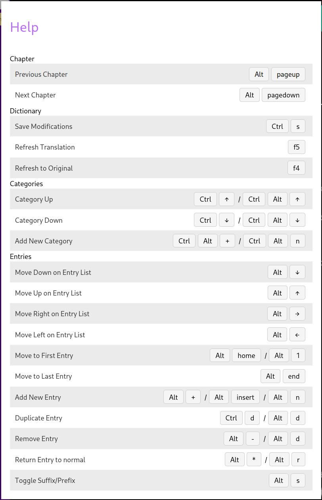

# MTL Tools

An interface to **back up Japanese web novels and partially translate their keywords**.

* **Backup:** insert a Syosetu (ncode) or Kakuyomu work id and every chapter is imported and stored in your own database, so you keep a copy even if the author deletes the source. Updates fetch new chapters and detect revised ones.
* **Keyword dictionaries:** while reading you build dictionaries (categories and entries, with prefixes and suffixes). The keywords are replaced in the text so a machine translator (Google Translate, DeepL, ...) keeps names and terms consistent.
* **Static pages:** each chapter is also served as a simple static page with the keywords already replaced. Translation services need to reach that page, so the app has to be reachable from the internet (a personal server, or a dynamic DNS name plus a forwarded port).

## Architecture

| Part | Tech | Role |
|---|---|---|
| `backend/` | Node 22, Fastify, Kysely, MariaDB | The API, static chapter pages, the Kakuyomu/Syosetu updaters, the job store and the weekly updater. Compiled (`dist/`) in production. |
| `resources/frontend/` | Angular 13 (AOT), Bulma | The single-page app. Lazy modules: dashboard, novel, chapter, dictionary, category and entry. The production build is copied into `public/`. |
| nginx | `nginx:1.27` | Serves the SPA from `public/`, proxies `/api/...` and `/static/...` to the Node backend, and serves `/images/` from disk. |
| MariaDB | `mariadb:11.4` | Novels, chapters, dictionaries. |

The frontend takes its API origin from `window.location.origin` in production, so the same build works behind any host name. No host name or secret is stored in the repository.

## Everything runs in Docker

No host Node or MariaDB is required. There is a production-style stack, plus a frontend toolchain and backend tooling.

### Production-style stack (`docker-compose.prod.yml`)

```bash
cp .env.example .env.prod      # fill in database values (never commit it); .env.prod.db holds the MariaDB container variables
docker compose -f docker-compose.prod.yml up -d --build
```

It starts nginx (published on port 8800, put your TLS reverse proxy in front of it), the Node backend (published only on `127.0.0.1:8801`) and MariaDB. Data lives outside git: `storage-prod/` holds the chapter cache, the generated static pages and the chapter images, and the database files live in the MariaDB data directory.

* **Fresh database:** create the tables from `backend/test/integration/schema.sql` (the schema the tests use).
* **Chapter images** are extracted from chapter text to disk (`storage-prod/app/public/images`) and served from `/images/` instead of being stored inside the database (`node dist/cli.js extract-images`).
* **Caches** are plain files under `storage-prod/app/node-cache/`, never an in-memory store of chapter text.
* Rebuild only the backend: `docker compose -f docker-compose.prod.yml up -d --build backend`. Rebuilding the backend resets its in-memory job state, so do it when no update is running.
* Build the frontend (Docker, production AOT) and copy it to `public/`: `sh build-front-production.sh`.

### Frontend toolchain (`docker-compose.yml`)

```bash
docker compose up node-app     # ng serve on http://localhost:4200
sh shell-node.sh               # shell inside the Node 18 / Angular 13 container
```

The dev server talks to the API origin set in `resources/frontend/src/environments/`. For backend work, `scripts/backend-tools.sh dev-on` runs the backend with live reload behind the production stack.

## Removed: the Laravel backend

The original Laravel (PHP) API was deleted in the commit "Remove legacy Laravel backend". It is still in git history. To bring it back, revert that commit (`git revert <sha>`), or check out its parent.

Backend development and tests also run in Docker (`docker-compose.backend.yml`, wrapped by `scripts/backend-tools.sh`). Details are in [backend/README.md](backend/README.md).

## Updating novels

* **Kakuyomu and Syosetu updaters** (Node): the Update button reads the source index (following Syosetu pagination), inserts new chapters, downloads missing text, and re-checks revision dates. Chapters are matched by their posted time, tolerating the one-hour shift old daylight-saving imports can have. A one-chapter update is also available.
* **Update indicator:** while an update runs, the novel list shows a banner with the phase and a progress bar, the novel's row gets an "Updating" tag and a spinner, and a green or red tag shows the result. The chapter list shows the same for its novel. The state is also restored when you reload the page while a job is running.
* **Jobs API:** `GET /api/jobs` returns the current (or just finished) update job. Also `GET /api/jobs/{id}`, `GET /api/jobs/{id}/events` (server-sent events) and `GET /api/jobs/kakuyomu/{novel}`. Job state is in memory only, one job at a time, and expires 15 minutes after it finishes.
* **Weekly background updater:** once a week (the `mtltools-weekly-update` user systemd timer, Thursday and Sunday at 12:30, `Persistent=true` so a missed run catches up after boot) the backend updates every novel that is not completed and whose driver is Syosetu or Kakuyomu (manual novels are skipped), one at a time with a pause between novels. If a source page answers 404/410 twice in a row (checked a minute apart), the novel is marked **completed**; timeouts, 5xx, rate limits and parse errors only get logged. A second run is refused while one is in progress.
  * `scripts/weekly-update.sh --dry-run` lists what would run, `--run` starts it, `--status` shows progress and the last summary (flags can be combined, for example `--run --status`).
  * The last summary is stored in `storage-prod/app/node-cache/weekly-update/last-run.json`. The trigger endpoint is internal (`/api/internal/weekly-update`, localhost only, not proxied by nginx).

## Tests and CI

* Unit and integration tests (Vitest, 126 tests; integration tests use a compose-managed MariaDB): `./scripts/backend-tools.sh test`. Typecheck: `docker compose -f docker-compose.backend.yml run --rm tools npm run typecheck`.
* Optional live canaries against the public sites: `npm run test:live` in the tools container.
* GitHub Actions (`.github/workflows/backend.yml`) runs `npm ci`, the tests (with a MariaDB service) and the TypeScript build for every change under `backend/`.
* Novel content (chapter text, images, SQL dumps) must never be committed; `.gitignore` covers the storage and dump folders.

# Screenshots


Dashboard: A list of all Novels and Dictionaries


List Novels: A more complete detailing of all novels registered, also contains extra information, and the list can be reordered.


Chapter List: When opening a novel, you see its chapters. They can also be reordered, but by default, newer chapters appear at the top.

The button "Update Chapters" will automatically search for new chapters and updates, so new chapters will appear at the top.

You can also check all dictionaries related to the novel.


When opening a chapter, you get a sidebar with the dictionary, its categories and entries.

As can be seen, replaced keywords are hilighted, and you can also click on them to be redirected to it's position on the Sidebar's dictionary.


If you hover your mouse at the sidebar, it will expand, revealing more options, you can chose a category, add and/or edit any entry, and update them dynamically in the main text (Click on the button "Refresh Translation", or if you want to remove them and go back to clean text, click on "Refresh to Original").


Entries added, edited or deleted (when they were already saved before) will be highlighted in different forms. Once you "Save Modifications", that will be final.

It also has support for suffixes and prefixes, very common in eastern languages. You may have to set up multiples if you need for more than one category though, but you can use the Hotkeys to duplicate an existing entry.


The same is valid for Categories, although there is no way to delete Categories from this screen (you can rename them).

They can be deleted from another screen though, but you are more likely to just want to rename them.


There are hotkeys for many of the main functions, including some only available through it (duplication, useful for suffixes/prefixes). Press F1 for this screen.


This is the "static page". It's a simple page with the text with the keywords already replace, and you can use it on any Machine Translation service you want.

But for this to work, this page needs to be accessible for the services, so either you host it on the internet, or you use a ddns and open a port on your own network for it to reach.


This is how the translated version appears, with the MTL and the source on the side (It uses CSS so that no MTL Service will try to translate it, but you also can't select/copy these).


This is another, less useful screen to edit Entries, but it allows you to move entries to different Categories (So if you inserted one in the wrong place, you use this screen).

It follows the same rules, with edited entries in green, deleted in red, added in blue.

The screen before it is also the one that allows you to delete categories (if needed).
